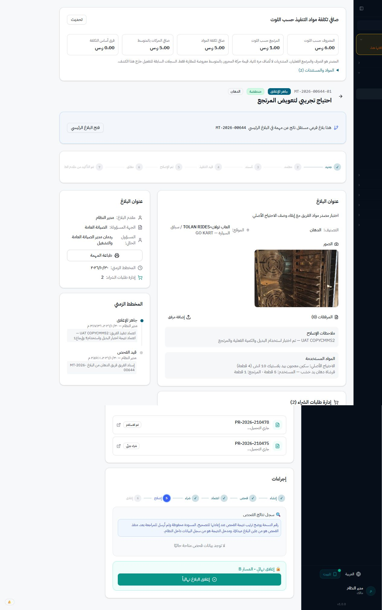

# قبول دورة التعويض والصرف — 2026-10-30

الحالة: نجح قبول البديل المختلف المرتبط باحتياج الفريق وPMV2 والصرف التشغيلي، والصرف العادي الجماعي. أغلقت المراجعة النهائية لمزج الأرصدة وحماية كمية الارتباط بالمصدر باختبارات معزولة. لا نشر أو تفعيل على cmms.

## البيئة

- localhost:4002، بعد فحص `SELECT DATABASE()` وإثبات COPYCMMS2.
- `tools/runtime-uat/start-copycmms2.ts` يمنع الإقلاع لأي اسم قاعدة آخر، ويعطل المجدولات والإرسال الخارجي للتنبيهات في عملية الاختبار فقط.
- لا DDL أو SQL يغيّر البيانات. عمليات القبول عبر واجهة البرنامج أو HTTP RPC المصادق عليه؛ SQL المستخدَم للتحقق للقراءة فقط.

## ما ثبت حيًا

| الحالة | النتيجة والدليل |
| --- | --- |
| إنشاء المستودع صرفًا من المخزون ببندين وموقعين وقسمين ومستلمين مختلفين | OPR-2026-000003، أنشئ من المتصفح؛ لا خصم حتى الاعتماد والتأكيد |
| FIFO والتأكيد المجمع | تأكيد واحد، DLV-2026-480002 من LOT-2026-00607، وDLV-2026-480003 من LOT-2026-00402 |
| المستلم الفعلي والافتراضي | الأول عبد الله سليمان بدل اسامه احمد، والثاني ازاد حسين عند ترك المستلم الفعلي فارغًا؛ تحقق الواجهة وسجلا السند |
| الكمية والتكلفة | 1 قطعة لكل بند، 2.50 + 2.90 = 5.40 ريال. الرصيد 24→23 و4→3 |
| منع إعادة الصرف بعد الاكتمال | RPC مصادق عليه بمفتاح جديد رُفض؛ بقي سندان وصافي5.40 دون تغيير |
| استكمال احتياج البلاغ القديم بعد البديل | RTN-2026-240004 → PR-2026-210473 → DLV-2026-480001. ظهر «بدء الإصلاح» للبلاغ MT-2026-00571-01؛ الضغط من المتصفح نقل حالته received_warehouse→in_progress. إنشاء/اعتمادات/شراء/استلام هذه المعاملة تمت قبل الجولة الحالية، ولم نكررها |
| بديل مختلف لاحتياج الصرف التشغيلي | OPR-2026-000004، الأصل PR-2026-210474، المرتجع RTN-2026-240005، البديل PR-2026-210476 في DPB-2026-000006. الأصل 1 ر.س والبديل 2 ر.س، فرق العهدة 1 ر.س فقط. استلام LOT-2026-00841 ثم DLV-2026-480004 بصافي تكلفة 2 ر.س؛ بقي اسم الأصل والاحتياج محفوظين |
| بديل مختلف لاحتياج فريق صيانة | MT-2026-00644-01، احتياج30001 أصله4 قطع. PR-2026-210475 → RTN-2026-240006 → خطة5/PR-2026-210478 → LOT-2026-00844 → TRF-2026-120001 → DLV-2026-480005. البديل6 قطع، المستخدم5 والمرتجع1 في RTN-2026-240008. اعتمدت نتيجة الفريق وأصبح البلاغ جاهزًا للإغلاق، دون تغيير صنف الأصل أو كميته |
| بديل مختلف لاحتياج PMV2 | المهمة180052/البند180185/الاحتياج120002: الأصل4 قطع في PR-2026-210477 → RTN-2026-240007 → خطة6/PR-2026-210479 → LOT-2026-00845 → TRF-2026-120002 → سند390006. استلام6 بديلة واستخدام5 وإرجاع1 في RTN-2026-240009، واكتمال البند مع بقاء وصف وصنف وكمية الأصل |
| الاعتمادات والفرق للفرق وPMV2 | الأصليان في DPB-2026-000007، والبديلان في DPB-2026-000008. لكل بديل قيمة6 ورصيد4 وفرق2 ر.س. المندوب الحقيقي AZIZ نفذ قبول المرتجع والتسعير والإرسال والشراء، والمالك نفذ الاعتمادين والاستلام عبر استثناء دوره القائم |
| منع تكرار التلبية | إعادة تشغيل إكمال الفريق بعد اعتماده، وإكمال PMV2 بعد اكتماله، أعادا نفس أرقام التحويل والسند والمرتجع دون حركات جديدة. في التشغيل أعاد المفتاح نفسه النتيجة السابقة ورُفض مفتاح جديد بعد الاكتمال |
| عرض الكميات الفعلية في البلاغ | بعد إعادة تحميل البلاغ2070004 ظهر «الاحتياج الأصلي…4 قطعة» وتحته اسم البديل و«المستخدم5 قطعة · المرتجع1 قطعة»، وصافي تكلفة اللوت5 ر.س. الدليل team-completed.jpg |

## طريقة القبول وحدوده

- إبقاء الاحتياج الأصلي وإضافة إسقاط لوتات البديل المستلمة المعتمدة، دون استبدال وصف الأصل أو تعديل فاتورته.
- كمية السند والتكلفة والاستخدام والمرتجع تبقى بوحدة الصنف الفعلي؛ تقدم الاحتياج يحسب بنسبة التغطية المعتمدة.
- الصرف العادي وبدء إصلاح البلاغ القديم والتحقق البصري للنتائج تمت من المتصفح. دورات الشراء/المرتجعات والتلبية الجديدة نفذت عبر HTTP RPC الحقيقي المصادق عليه، مع الحراس والكتّاب والمعاملات القائمة؛ ليست SQL أو استدعاءات خدمة داخلية تتجاوز المسار.
- لم نختبر الاعتماد بحساب محاسب وحساب إدارة عليا منفصلين في هذه الجولة؛ استخدم المالك الاستثناء القائم. اختبارات الحراس والأدوار المعزولة تبقى دليل التحقق من السماح والمنع، لا يُنسب تنفيذ حي لأدوار لم تسجل الدخول.
- أول عينة PMV2 توقفت عند اختلاف وحدة مخزون قديم حتى مع رصيد صفر، دون إنشاء شراء. لم نلغ حارس الوحدة؛ أعيدت التجربة بصنف آخر نظيف. أوقف البرنامجان التجريبيان60001 و60002 عبر API بعد الاختبار لمنع توليد مهام لاحقة، مع بقاء التاريخ.
- سيناريو إعادة إرجاع البديل نفسه قبل صرفه يحتاج قرار المستخدم بشأن دورة تعويض متتابعة؛ لم يُنفذ أو يُقبل في هذه الجولة ولا يُعد نجاح التعويض المباشر إثباتًا له.
- لا معالجة لكشف الإكسل المؤجل، ولا تغيير .env، ولا ترحيل أو تفعيل على cmms، ولا نشر Railway ضمن هذه الجولة. يلزم نشر مستقل للنسخة المختارة وضبط مفتاح الإنتاج فقط عند اعتماد التفعيل.

## التحقق المحلي

- `node tools/supplier-return-followup/run.mjs`: 274/274 بعد المراجعة النهائية.
- `operational-prepared.vitest.config.mjs`: 216/216.
- `node tools/read-scope-perf/run.mjs`: 399/399.
- `materials-display.vitest.config.mjs`: 22/22، و`webPushTrialOptOut` حالتان ناجحتان.
- المراجعة الأخيرة أثبتت مزج رصيدين: احتياج4 وبديل6، منه5 متاحة ومعه2 من الأصل، يختار3 بديلة تغطي2 أصلية ثم2 أصلية، دون تقريب. وكذلك تخطي خطة لا تسمح بإكمال الكمية لصالح خطة أخرى صالحة؛ اختبار المحلل يقارن نتائج أعداد صغيرة بحصر شامل مستقل، مع حد لعمل البحث.
- حصة المصدر في الفريق محدودة بكمية purchase supply المرتبطة به، مع نفس التحقق في القراءة والكتابة؛ الزيادة للمستودع لا تُحسب على الاحتياج. عندما يكون البديل بنفس صنف الأصل، تُستبعد لوتاته من رصيد الأصل حتى لا تحسب مرة بنسبة الخطة ومرة1:1.
- حدود النظام الحالية محفوظة: سندات الكميات الفعلية صحيحة، وحساب التغطية دقيق بثلاث منازل؛ مسار استلام البديل الحالي يستلم الخطة كاملة في عملية واحدة ولوت واحد. لم نوسع الاستلام إلى تقسيمات جديدة تتطلب نسبًا غير قابلة للتمثيل.
- بعد البناء الأخير وحارس حصة المصدر، أعيدت `team-complete` و`pmv2-complete` و`operational-replacement-receive-issue` و`duplicate-operational` على الخادم الجديد؛ نجحت الأربع بنفس المعاملات دون حركات جديدة. أُعيد تحميل البلاغ2070004 من المتصفح وأثبت الأصل4/المستخدم5/المرتجع1/الصافي5ر.س وحالة جاهز للإغلاق. صفحة القبول تُركت مفتوحة للمراجعة على4002.
- بناء الإنتاج ناجح. فحص TypeScript العام ما زال غير نظيف بسبب تشخيصات سابقة؛ لم يجر إعلان نظافة المشروع كله. اختبارات PMV2 القديمة التي تفحص نص المصدر لها16 فشلًا مثبتًا على HEAD السابق أيضًا، منفصلة عن اختبارات السلوك الجديدة.

